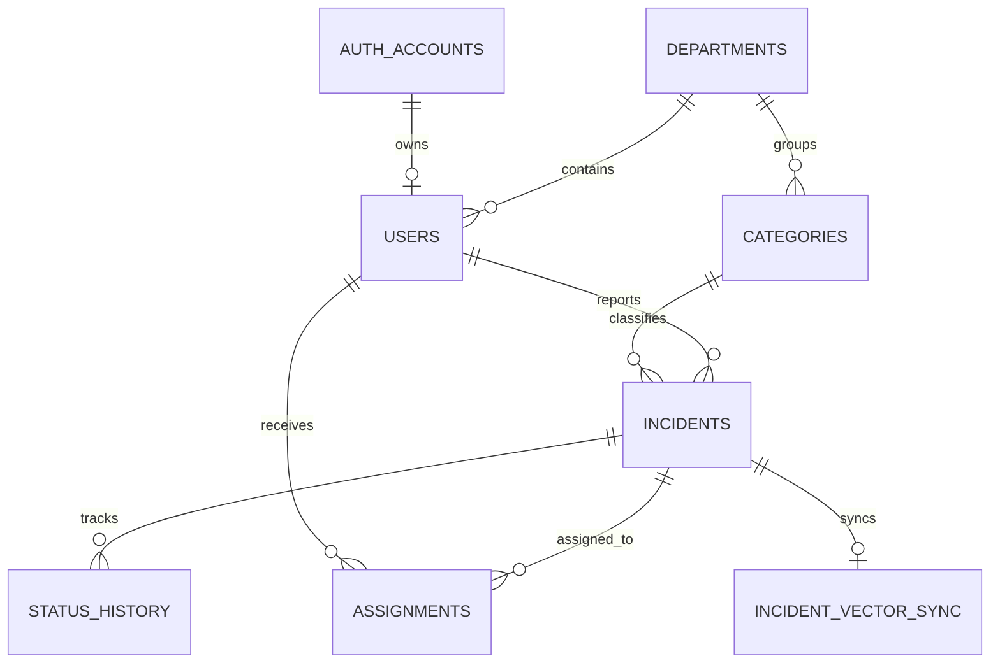

# SmartCivic Project Documentation

## 1. Problem statement
SmartCivic is a civic incident reporting and management platform designed to help residents report local issues such as potholes, sanitation problems, water leaks, and electrical faults. The application aims to improve public service response times by connecting residents to departments, officers, and administrators in a single workflow.

## 2. Objectives
- Let residents report incidents with structured metadata and clear local context.
- Allow administrators to review, assign, and monitor incident progress.
- Enable department officers and managers to handle the incidents assigned to their departments.
- Use a database-backed system that demonstrates relational design and modern web application integration.
- Provide a role-based dashboard that demonstrates database-driven authorization.

## 3. Scope
The project covers the full end-to-end lifecycle of a civic service request:
- user registration and portal-based login
- incident submission
- category and department mapping
- assignment to officers
- status updates and history tracking
- basic reporting and dashboard summary views

## 4. Functional requirements
- Residents can create accounts and submit incident reports.
- Residents can edit or delete their own pending or assigned reports before work starts. Editing clears the prior assignment, returns the incident to pending admin review, and records the change in status history; admins can then reassign it or reject it.
- Incidents include fields for title, description, category, location, and priority.
- Administrators can review all incidents and assign them to officers.
- Administrators can edit department names, deactivate/restore departments, and update or revoke officer access.
- Administrators can update incident statuses; department managers can update incidents in their department, and officers can update only incidents assigned to them. Changes are persisted and recorded in activity history.
- Managers can access department-level work in a restricted view.
- Activity history is recorded when status changes occur.

## 5. ER diagram

## 6. Relational schema
The core SQL schema is implemented in PostgreSQL and includes:
- `auth_accounts`
- `users`
- `departments`
- `categories`
- `incidents`
- `status_history`
- `assignments`

Key foreign keys and constraints are enforced to maintain referential integrity and valid state transitions.

## 7. Database choice and justification
PostgreSQL is the primary SQL database because the incident workflow depends on relational integrity, joins, transactions, and role-aware access. Qdrant is the separate vector database; using a separate service avoids requiring a PostgreSQL extension and permits the existing SQL hosting configuration to remain unchanged.

Incident title, description, and location are converted into 384-dimensional vectors by the deterministic `smartcivic-feature-hash-v1` feature-hashing embedding implementation. It tokenizes text, hashes tokens and adjacent-token features into a fixed vector, and L2-normalizes the result. This local approach requires no paid API or model download; it provides lexical feature similarity, not the deep semantic quality of a pretrained language model. Vectors are stored as Qdrant points in the `smartcivic_incidents` collection and compared using cosine similarity. Search results are restricted to incidents visible to the authenticated role.

## 8. Data dictionary / schema description
| Table | Purpose | Important fields |
| --- | --- | --- |
| `auth_accounts` | stores login credentials and identity | `account_id`, `email`, `password_hash` |
| `users` | stores the person profile and portal role | `user_id`, `role`, `department_id`, `auth_account_id` |
| `departments` | stores municipal department definitions | `department_id`, `department_name` |
| `categories` | links issue types to departments | `category_id`, `category_name`, `department_id` |
| `incidents` | stores the actual report details | `incident_id`, `title`, `description`, `status`, `priority`, `location` |
| `status_history` | stores previous state changes | `history_id`, `incident_id`, `old_status`, `new_status`, `changed_by` |
| `assignments` | stores officer allocation info | `assignment_id`, `incident_id`, `officer_id`, `assigned_by` |
| `incident_vector_sync` | SQL outbox tracks vector indexing/retry state | `incident_id`, `indexed_at`, `last_error`, `updated_at` |

## 9. SQL and vector database implementation
### SQL implementation
- PostgreSQL relational schema in `db/migrations/*.sql`
- Primary keys, foreign keys, constraints, and inserts seeded for departments and categories
- Role-aware queries and status updates via API routes

### Advanced PostgreSQL features
- Transactions for incident creation, officer creation, assignment, and status changes.
- View `department_incident_summary` for department-level incident totals.
- Trigger function `maintain_incident_search_vector` keeps full-text search data current.
- B-tree and GIN indexes support incident filtering, assignment lookup, activity history, and full-text search.
- Full-text search uses PostgreSQL `websearch_to_tsquery`.
- Qdrant stores 384-dimensional cosine vectors and uses its HNSW-based nearest-neighbor index.

### Vector data and retrieval
- Embedded data: incident title, description, and location.
- Embedding implementation: local deterministic feature hashing, model identifier `smartcivic-feature-hash-v1`, 384 dimensions.
- Storage: Qdrant collection `smartcivic_incidents`; point IDs are SQL incident IDs, with the embedding model recorded in point payload.
- Similarity metric: cosine similarity; the API exposes Qdrant's cosine score.
- Retrieval: `/api/incidents/search?q=...` searches only among the authenticated user's SQL-visible incident IDs and returns at most 20 results.
- SQL outbox rows are committed with incident create/edit operations. Qdrant updates occur after the SQL transaction; failed indexing is logged and marked for retry, and searches backfill visible incidents that are not yet indexed.

## 10. Important queries
Examples implemented in the app include:
- fetch all incidents for a resident, officer, or admin
- list matching officers for an incident department
- fetch incident history by department/role
- update status and insert log entries into `status_history`
- retrieve vector-nearest incident matches from Qdrant with cosine similarity

Representative relational query patterns are present in:
- [app/api/incidents/route.ts](app/api/incidents/route.ts)
- [app/api/incidents/status/route.ts](app/api/incidents/status/route.ts)
- [app/api/assignments/route.ts](app/api/assignments/route.ts)

## 11. System architecture
The application follows a Next.js app-router architecture:
- Frontend: Next.js pages and components
- Backend: App Router API routes
- Relational DB: PostgreSQL
- Vector DB: Qdrant
- Authentication: signed server-side session tokens

## 12. Application screenshots
Capture and include actual screenshots before submission; do not treat this list as completed evidence:
- civic login and report form
- admin dashboard and incident table
- officer assigned incidents panel
- department management page
- civic incident edit/delete and similarity-search results

## 13. Testing results
Record the actual environment and outputs before submission:
- Production build: run `npm run build`.
- Lint: run `npm run lint`.
- Database integration: run all SQL migrations against PostgreSQL, start/configure Qdrant, then test sign-in, incident CRUD, role restrictions, department/officer management, and vector similarity search.
- Include screenshots or saved output for each test. A successful build alone does not verify database migrations or runtime operations.

## 14. Team and contribution record
Contribution details below are based on the team-provided descriptions. Add commit links, screenshots, or demo evidence before submission:

| Member | Database contribution | Application contribution | Evidence (commits/demo) |
| --- | --- | --- | --- |
| Shreyan Ganesh | Initial PostgreSQL configuration and database creation; designed and implemented the relational schema, constraints, indexes, and seeded department/category data; added database support for incident search and vector synchronization. | Set up the Next.js application structure and configuration; implemented the core incident-management workflows and their PostgreSQL integration, including incident reporting and retrieval, category/department association, incident data validation, resident report editing/deletion before work starts, and return of edited reports to admin review; implemented incident text embedding, Qdrant synchronization, and vector similarity search. | Add commit links, screenshots, or demo evidence |
| Sri Ram V | PostgreSQL application integration and migrations for account, department active status, and department manager designation. | Implemented the civic and administrator login portals and dashboards, public civic account registration, authenticated role-based routing, and incident reporting and tracking; built admin incident review, assignment and reassignment, department management, and activity-history workflows; created the department officer portal and manager workflows, including officer credential/access management; implemented role-restricted status updates with actor-attributed activity history; added periodic portal refresh and readable wrapping for long incident-table text; addressed missing database fields and Next.js instant-navigation warnings; updated project setup and submission documentation. | Add commit links, screenshots, or demo evidence |

### Shreyan Ganesh — database and incident search implementation details
- Initialized the Next.js project structure and application configuration.
- Configured the initial PostgreSQL connection and database, then implemented the relational schema, constraints, indexes, and seeded department/category records.
- Implemented the core incident-management data flow between the application and PostgreSQL, including incident submission and retrieval with category/department mapping and validated report fields.
- Added database support for incident text search and the SQL vector-sync outbox.
- Implemented resident incident editing and deletion before work starts, returning edited incidents to administrator review and assignment.
- Integrated incident text embeddings, Qdrant synchronization, and vector similarity search.

### Sri Ram V — portal and incident workflow implementation details
- Implemented the civic and administrator sign-in pages and dashboards, plus public civic account registration and portal-aware routing after authentication.
- Built the civic report submission and personal incident tracking experience, and the admin dashboard for reviewing reports, assigning incidents, managing departments, and reviewing activity history.
- Added a separate officer sign-in and protected dashboard, with routing based on the authenticated account role.
- Added department manager designation and a database migration to mark an existing officer as manager when a department does not yet have one.
- Required manager credentials when an administrator creates a department. Added administrator controls to configure manager credentials for existing departments and create additional officer accounts; credentials are stored as password hashes.
- Added administrator editing for officer names, email addresses, and passwords without displaying stored password hashes.
- Implemented role-aware incident lists: managers see incidents for their department, while other officers see incidents assigned to their accounts.
- Allowed admins and officers in the incident's department to update status. Status updates are stored in `incidents` and recorded in `status_history` with the actor, so the administrator activity history shows who made each change.
- Added periodic refresh to incident lists and activity history so updates become visible across portals without manually reloading.
- Applied fixed-layout, wrapping styles to incident tables so long titles, descriptions, locations, and other text remain within their cells across officer, admin, civic, and activity-history views.

## 15. Conclusion and future enhancements
SmartCivic demonstrates a role-based incident workflow using PostgreSQL and Qdrant. It connects relational integrity, transactions, full-text indexing, and vector similarity retrieval to a functional Next.js application.

Future enhancements could include:
- a pretrained multilingual embedding model to improve semantic search beyond feature-hash similarity
- advanced analytics and charts
- email notifications and escalation workflow
- stronger auditing and export features

## Submission checklist items to complete
- Confirm the title is unique within the course section and record instructor/team details.
- Replace the contribution placeholders with the actual team members and evidence.
- Capture actual application screenshots and test results.
- Verify that Qdrant is reachable and that migrations `001` through `005` were applied successfully.
- Review the originality requirements and cite any external libraries, templates, or reference material used.
